# Sistema de Chamados

Sistema web para gestão de chamados, desenvolvido na disciplina de Design e Arquitetura de Sistemas (Univille). É composto por uma API REST e por uma interface web que consome essa API.

## Tecnologias

- **Back-end:** Java 21, Spring Boot 4.1.1, Maven, Spring Web, Spring Data JPA, Bean Validation e H2.
- **Front-end:** HTML, CSS e JavaScript, com Bootstrap 5.3 e Bootstrap Icons. Não há etapa de build: as páginas são servidas pelo próprio Spring Boot.

## Como executar

No Windows:

```
.\mvnw spring-boot:run
```

No macOS ou Linux:

```
./mvnw spring-boot:run
```

A interface web e a API ficam disponíveis em:

```
http://localhost:8080
```

### Banco de dados

O banco é H2 em memória, então os dados são apagados quando a aplicação é reiniciada. Para consultá-lo, acesse o console:

```
http://localhost:8080/h2-console
```

No campo **JDBC URL**, informe:

```
jdbc:h2:mem:chamadosdb
```

No campo **User Name**, informe o usuário abaixo e deixe a senha em branco:

```
sa
```

## Rotas e exemplos de teste

Cada etapa traz as rotas criadas e um exemplo de teste. Os exemplos foram executados no Postman, em sequência e com a aplicação recém-iniciada, e as imagens mostram a requisição enviada e a resposta recebida.

### 1. Clientes

| Método | Rota | Ação | Sucesso |
|---|---|---|---|
| POST | `/clientes` | Criar cliente | 201 Created |
| GET | `/clientes` | Listar clientes | 200 OK |
| GET | `/clientes/{id}` | Buscar por id | 200 OK |
| PUT | `/clientes/{id}` | Atualizar cliente | 200 OK |
| DELETE | `/clientes/{id}` | Excluir cliente | 204 No Content |

Erros tratados: 400 para dados inválidos, 404 para cliente inexistente e 409 para e-mail já cadastrado.

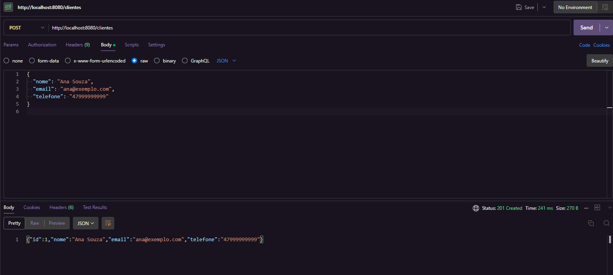

### 2. Categorias

| Método | Rota | Ação | Sucesso |
|---|---|---|---|
| POST | `/categorias` | Criar categoria | 201 Created |
| GET | `/categorias` | Listar categorias | 200 OK |
| GET | `/categorias/{id}` | Buscar por id | 200 OK |
| PUT | `/categorias/{id}` | Atualizar categoria | 200 OK |
| DELETE | `/categorias/{id}` | Excluir categoria | 204 No Content |

Erros tratados: 400 para dados inválidos, 404 para categoria inexistente e 409 para nome já cadastrado.

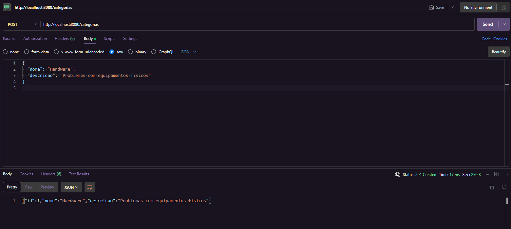

### 3. Técnicos

| Método | Rota | Ação | Sucesso |
|---|---|---|---|
| POST | `/tecnicos` | Criar técnico | 201 Created |
| GET | `/tecnicos` | Listar técnicos | 200 OK |
| GET | `/tecnicos/{id}` | Buscar por id | 200 OK |
| PUT | `/tecnicos/{id}` | Atualizar técnico | 200 OK |
| DELETE | `/tecnicos/{id}` | Excluir técnico | 204 No Content |

O campo `perfil` aceita `ADMIN` ou `TECNICO`. Erros tratados: 400 para dados inválidos, 404 para técnico inexistente e 409 para e-mail já cadastrado.

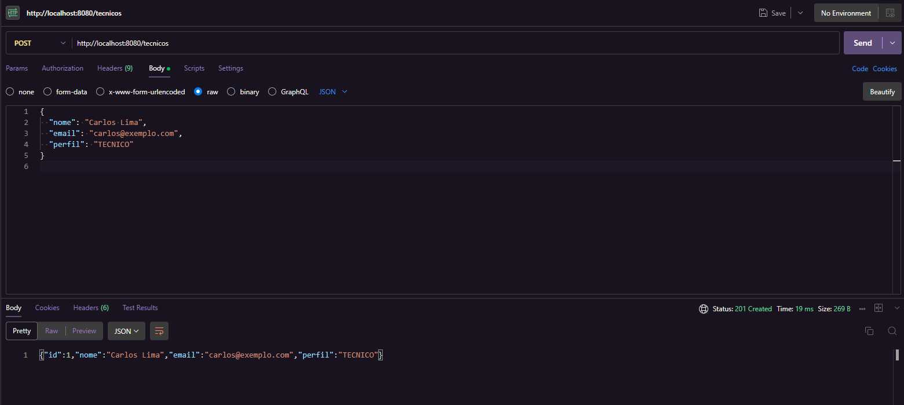

### 4. Chamados

| Método | Rota | Ação | Sucesso |
|---|---|---|---|
| POST | `/chamados` | Abrir chamado | 201 Created |
| GET | `/chamados` | Listar chamados, com filtros e paginação | 200 OK |
| GET | `/chamados/{id}` | Detalhe do chamado, com comentários | 200 OK |
| PUT | `/chamados/{id}` | Atualizar chamado | 200 OK |
| DELETE | `/chamados/{id}` | Excluir chamado e seus comentários | 204 No Content |

O chamado nasce com status `ABERTO` e com a `dataAbertura` preenchida automaticamente. A `prioridade` aceita `BAIXA`, `MEDIA`, `ALTA` ou `CRITICA`. Erros tratados: 400 para dados inválidos e 404 para chamado, cliente ou categoria inexistente.

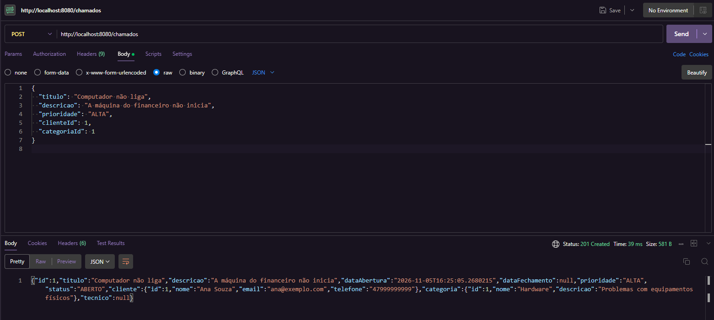

### 5. Regras de negócio

| Método | Rota | Ação | Sucesso |
|---|---|---|---|
| PATCH | `/chamados/{id}/atribuir` | Atribuir técnico | 200 OK |
| PATCH | `/chamados/{id}/status` | Alterar status | 200 OK |

O `status` aceita `ABERTO`, `EM_ATENDIMENTO`, `AGUARDANDO_CLIENTE` ou `FECHADO`.

- Ao fechar o chamado, a `dataFechamento` é preenchida automaticamente.
- Um chamado fechado não pode ser alterado, receber técnico, mudar de status nem receber comentários. Essas tentativas retornam 409.

O exemplo abaixo fecha o chamado aberto no exemplo anterior, depois de atribuído ao técnico.

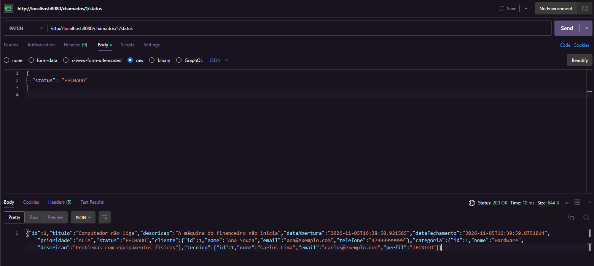

### 6. Filtros e paginação

| Método | Rota | Ação | Sucesso |
|---|---|---|---|
| GET | `/chamados?status=&prioridade=&clienteId=` | Filtrar chamados | 200 OK |
| GET | `/clientes/{id}/chamados` | Chamados de um cliente | 200 OK |

Os exemplos de consulta estão na seção [Exemplos de consulta](#exemplos-de-consulta).

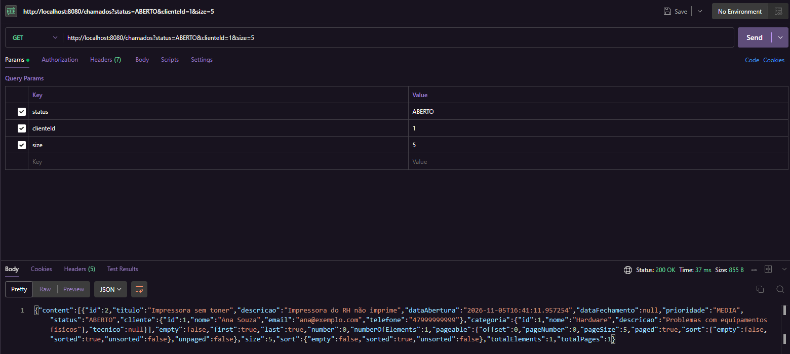

### 7. Comentários

| Método | Rota | Ação | Sucesso |
|---|---|---|---|
| POST | `/chamados/{id}/comentarios` | Comentar no chamado | 201 Created |

A `data` do comentário é preenchida automaticamente. Os comentários aparecem no detalhe do chamado (`GET /chamados/{id}`), do mais antigo para o mais novo. Erros tratados: 400 para dados inválidos, 404 para chamado inexistente e 409 para chamado fechado.

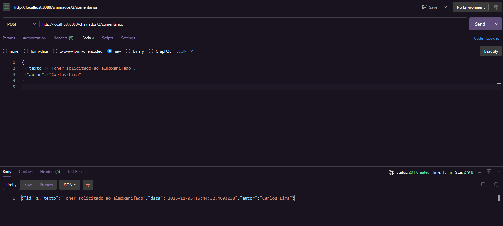

## Exemplos de consulta

### Filtros

Os filtros de `GET /chamados` são opcionais e podem ser combinados.

| Parâmetro | Valores |
|---|---|
| `status` | `ABERTO`, `EM_ATENDIMENTO`, `AGUARDANDO_CLIENTE`, `FECHADO` |
| `prioridade` | `BAIXA`, `MEDIA`, `ALTA`, `CRITICA` |
| `clienteId` | id do cliente |

```
GET /chamados?status=ABERTO
GET /chamados?prioridade=ALTA&clienteId=1
GET /chamados?status=FECHADO&prioridade=ALTA&clienteId=1
```

### Paginação e ordenação

| Parâmetro | Descrição | Padrão |
|---|---|---|
| `page` | Número da página, começando em 0 | `0` |
| `size` | Itens por página | `10` |
| `sort` | Campo e direção | `dataAbertura,desc` |

```
GET /chamados?page=0&size=5
GET /chamados?sort=titulo,asc
GET /chamados?status=ABERTO&page=0&size=5&sort=titulo,asc
```

Ordenar por `prioridade` segue a ordem alfabética dos valores, e não a ordem de importância.

### Chamados de um cliente

Retorna 404 se o cliente não existir. Aceita `page`, `size` e `sort`.

```
GET /clientes/1/chamados
GET /clientes/1/chamados?page=0&size=5
```

### Formato da resposta

As consultas retornam uma página, com os itens em `content` e os totais em `totalElements` e `totalPages`. O exemplo da etapa 6 mostra a resposta completa.

## Interface web

Com a aplicação rodando, abra no navegador:

```
http://localhost:8080
```

A interface usa as mesmas rotas da API descritas acima e não exige login. Os endereços da tabela abaixo são links e abrem a tela direto quando a aplicação está rodando.

### Telas

| Tela | Endereço | O que permite |
|---|---|---|
| Dashboard | [localhost:8080](http://localhost:8080) | Ver a quantidade de chamados por status e por prioridade, os últimos chamados e o total de cadastros |
| Chamados | [localhost:8080/chamados.html](http://localhost:8080/chamados.html) | Listar, filtrar por status, prioridade e cliente, ordenar, paginar e abrir chamados |
| Detalhe do chamado | [localhost:8080/chamado.html?id=1](http://localhost:8080/chamado.html?id=1) | Editar, excluir, alterar o status, atribuir técnico e comentar |
| Clientes | [localhost:8080/clientes.html](http://localhost:8080/clientes.html) | Listar, buscar, cadastrar, editar e excluir clientes |
| Detalhe do cliente | [localhost:8080/cliente.html?id=1](http://localhost:8080/cliente.html?id=1) | Ver os dados de contato e os chamados do cliente |
| Categorias | [localhost:8080/categorias.html](http://localhost:8080/categorias.html) | Listar, buscar, cadastrar, editar e excluir categorias |
| Técnicos | [localhost:8080/tecnicos.html](http://localhost:8080/tecnicos.html) | Listar, buscar, filtrar por perfil, cadastrar, editar e excluir técnicos |

- Os erros da API, como validação, registro duplicado ou chamado fechado, aparecem como mensagens na tela.
- Os filtros da lista de chamados ficam no endereço da página, então continuam aplicados ao recarregar ou voltar.
- Um chamado fechado tem a edição, a troca de status, a atribuição e os comentários bloqueados, seguindo a regra da API.
- O layout se adapta ao celular: o menu lateral vira uma gaveta e as tabelas mostram só as colunas principais.

### Organização dos arquivos

Os arquivos ficam em `src/main/resources/static`.

```
static/
├── index.html, chamados.html, chamado.html, clientes.html,
│   cliente.html, categorias.html, tecnicos.html
├── css/
│   └── style.css              estilos do sistema
└── js/
    ├── api.js                 chamadas à API, mensagens e funções comuns
    ├── layout.js              menu lateral, montado em todas as páginas
    ├── formulario-cliente.js  janela de cadastro de cliente, usada em duas telas
    └── um arquivo por tela    dashboard.js, chamados.js, chamado.js...
```

### Imagens

Dashboard:

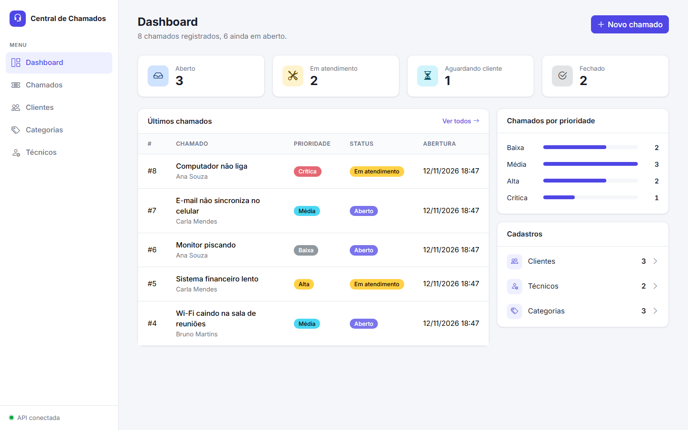

Lista de chamados:

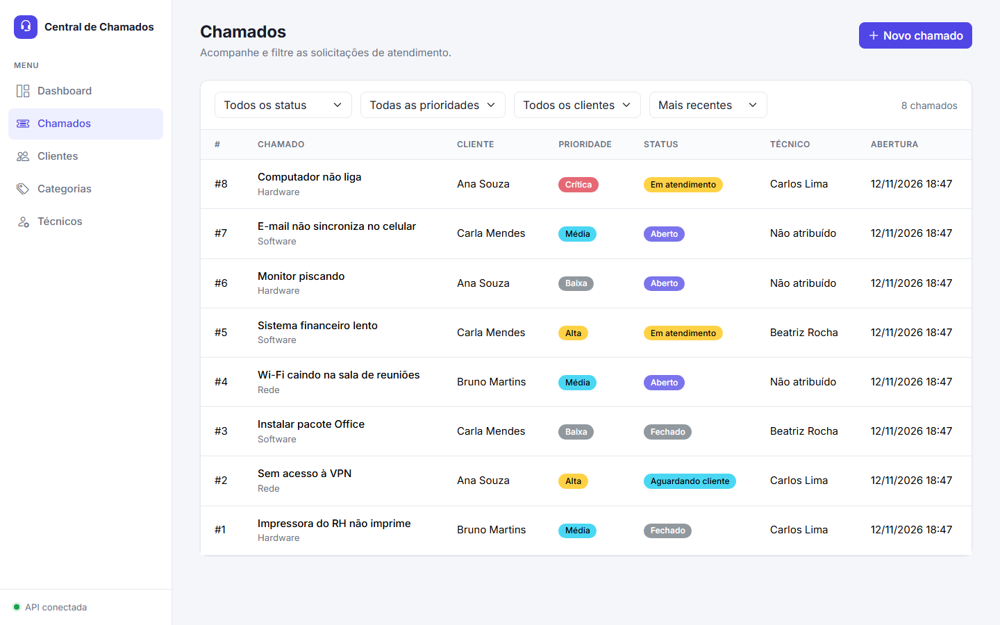

Abertura de chamado:

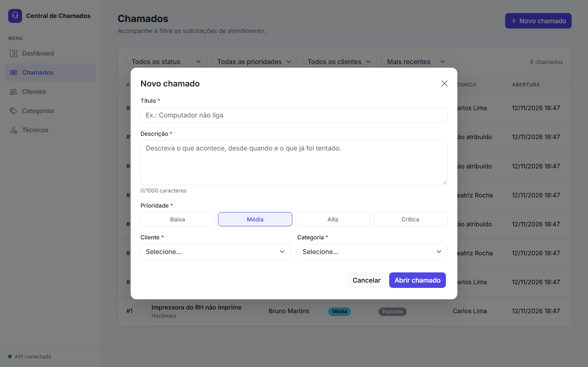

Detalhe do chamado, com o andamento e os comentários:

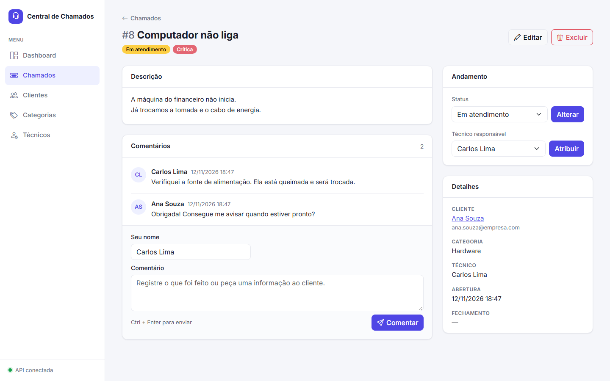

Detalhe do cliente:

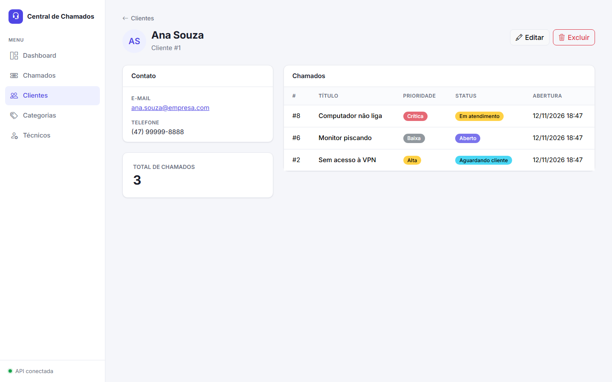
